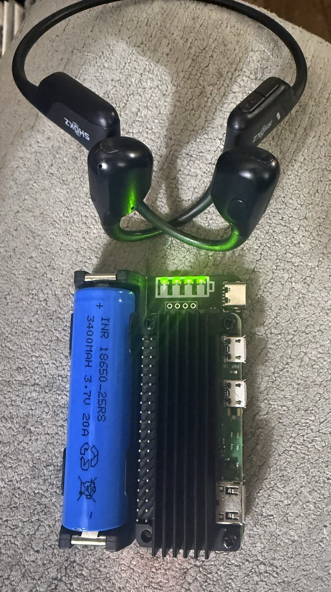

# EdgeCDSS Pocket

A wearable voice dose assistant. Signed doses only, no language model, no network.

> **Research prototype.** Not validated for clinical use. Not for patient care. Simulated scenarios only. Enter no patient information (PHI).

[Project site](https://ai-in-austere-medicine-project.github.io/pi-cloud-cdss/web/) · [Portal](https://cdss.arcanekg.com) · [Substack](https://aiamp.substack.com)

<p align="center"></p>
A wearable that gives a signed drug dose in millilitres by voice. No language model, no network, no screen.

Say "ketamine for moderate pain, IV, eighty kilos." It says "Ketamine, moderate to severe pain analgesia, eye vee, eighty kilos. Confirm?" Say "confirm." It says "Ketamine twenty milligrams. Dilute one mil of fifty in nine mils of normal saline. Four mils of the dilution, five per mil." It logs the time.

That is the signed 0.25 mg/kg. At the kit's 50 mg/mL vial it would be 0.4 mL, under the 0.5 mL that can be drawn reliably, so the volume comes from the signed dilution instead: 1 mL of the vial in 9 mL of normal saline, 5 mg/mL. The device says how to make it before it says how much to draw.

Part of the [AI in Austere Medicine Project](https://github.com/AI-in-Austere-Medicine-Project). 

## The three rules

1. **Nothing on the device can say a number that was not signed.** Every dose, cap, dilution and vial strength comes from the exported signed bank. There is no model and no free-text path.
2. **Read-back before any dose.** The device repeats drug, indication, route and weight and acts only on "confirm."
3. **Every confirmed dose is logged with a time.** The log leaves the device only by deliberate export.

## Hardware (about $75, plus any Bluetooth headset)

| Part | Choice | List price |
|---|---|---|
| Board | Radxa ZERO 3W, 1 GB, no eMMC (recommended; see Boards tested below) | $20.00 (Radxa's store, Arace) |
| Sound out | Any Bluetooth headset; its button is push-to-talk. It pairs with any headset, so it is not in the totals. | — |
| Speech in | A USB mini microphone on a USB-C OTG adapter, until the headset mic is verified at 16 kHz. On the board's Debian the headset mic is 8 kHz, so the USB mic is used meanwhile ([device/RADXA.md](device/RADXA.md)). | $5.95 mic (Adafruit 3367) + $0.95 adapter (Adafruit 5030) |
| Power | 3.7 V LiPo, 3,400 mAh or more, with a 5 V / 1 A charge-boost board; solar compatible. Runtime on the ZERO 3W is not yet measured. | $19.95 battery (Adafruit 354, 4,400 mAh) + $18.50 charge-boost board (SparkFun LiPo Charger/Booster 5V/1A) |
| Storage | microSD, 16 GB or more; read-only root, separate log partition | about $8 (a 32 GB card) |
| Case | Printed, forearm strap or clip | about $2 of filament |

Prices are list prices on 2026-11-16, before shipping and tax.

### Boards tested

| | Radxa ZERO 3W, 1 GB (recommended) | Raspberry Pi Zero 2 W |
|---|---|---|
| Parts total, without the headset | about $75 | about $76 (a micro-USB OTG adapter, $2.95 Adafruit 2910, in place of the USB-C one) |
| Board price and availability | $20.00 at Radxa's store (Arace); out of stock on 2026-11-16 | $19.05 at Adafruit (5291); out of stock on 2026-11-16 |
| Memory (Vosk, Piper and the engine in one process) | Peak 329 MB, nothing in swap (2026-11-11, an 8 GB module on the bench). Clears the 100 MB floor on the 1 GB model. | About 300 MB, of which about 165 MB is in swap, against the 415 MB that reaches Linux; 66–89 MB available. Below the 100 MB floor (2026-11-09). |
| Time to a spoken answer, from release | About 2 s: Vosk finishes 0.12 s after release, then Piper says the dose sentence in 1.86 s. | About 4–6 s: Vosk finishes 0.17 s after release, then Piper takes 3.4–5.6 s. Once Piper has run, Vosk is slower than real time, because its pages come back from swap. |

The Pi Zero 2 W runs Pocket, but below the memory floor. The Radxa ZERO 3W is recommended. The measurements are in [device/RADXA.md](device/RADXA.md) and [docs/BOARDS.md](docs/BOARDS.md).

## Software

| Layer | Choice |
|---|---|
| OS | Raspberry Pi OS Lite 64-bit, boots to the service |
| Speech in | Vosk small English model with a **grammar** generated from the bank (drug names and aliases, indications, routes, numbers, control words). Nothing outside the grammar is recognised. |
| Engine | Python, ported from EdgeCDSS's pre-gate: signed lookup by drug, indication, route, population; caps; kit vial and signed dilution to mL; the weight and which-indication questions. Same tests. |
| Speech out | Piper small English voice with the EdgeCDSS spoken templates (numbers and units written out) |
| Content | `bank.json` exported from EdgeCDSS with every entry's source, page, quote, signer and date; `kit.json` with the declared vial strengths. The device refuses to start on an unsigned or EXAMPLE bank. |
| Log | Append-only JSON lines; export over USB on the bench |

## Vocabulary

Drug names and aliases from the bank; indication names from the bank; routes (IV, IO, IM, IN, PO, NEB, "line", and "intravenous", "in the vein", "intramuscular", "intraosseous", "by mouth", "oral", "intranasal"); numbers, "kilos," "pounds," "estimated"; "child," "years"; conditions the medic can state ("burns," "crush injury," "head injury," "asthma"), each one found in the signed contraindications or cautions; control words: confirm, cancel, repeat, why, new patient, log, battery. About forty words plus numbers.

What Vosk can hear (`grammar/vosk_grammar.json`) is narrower than what the typed parser reads (owner, 2026-11-15):
- **Signed drugs only.** The grammar's drug words, and their phonetic spellings, come only from the bank's signed drugs. An unsigned drug cannot be heard as itself or pull a nearby sound to it: said, it is "Not recognised." Typed, it still holds by name ("No signed dose for magnesium.").
- **Confused pairs ask first.** A pair that the owner's clips or the sound-alike checks confuse is listed in `grammar/confusable.json` with where it was seen. When it is heard, Pocket always asks "X or Y?" before the read-back, and the answer settles it. The pairs today are epinephrine and norepinephrine, and IM and IN said by letters. "intramuscular" and "intranasal" do not ask. Typed text cannot be misheard, so it does not ask.
- **Words left out.** Three entries the parser reads are left out because they took the "v" of a spoken "i v" (`voice/grammar.py`, `NOT_IN_GRAMMAR`). "dvt" is now said as "blood clot" or "thrombosis"; "norepi" spelled "no ip" is left out, and norepinephrine is still heard by its other names.

## Flow

- "New patient" clears weight and age and says so.
- A phrase with drug + indication (+ route, + weight) goes to the engine. A missing weight gets "Weight?"; a missing indication for a multi-indication drug gets "Which indication: pain or agitation?"; a name close to two drugs (ketamine / ketorolac) always asks.
- A stated condition that a signed contraindication names holds the dose: no read-back, no dose. "Succinylcholine, RSI, eighty kilos, burns" → "Held. Succinylcholine is contraindicated with burns. Rocuronium is the signed alternative." The alternative is another signed drug for the same indication that this patient's conditions do not hold. A contraindication the signed text itself qualifies ("relative", "unless", "except") is spoken after the dose instead.
- Read-back, then "confirm" → dose in mg and mL from the kit vial or signed dilution. Dose first, then only the cautions that name a condition the medic stated. Logged.
- "Why" speaks the source (quotes word for word), then every caution and contraindication. When no volume was given, a spoken caution leaves out what states a volume ("10 mL", "0.1 mL/kg"); concentrations ("1 mg/mL", "1:1,000") stay. The signed text in `bank.json` is unchanged.
- A stated vial that is the kit's signed vial ("fifty milligrams per mil" for ketamine) gives the volume; any other stated vial gives milligrams only. The words are compared with the signed vial's; nothing is computed from them.
- Unsigned drug: "No signed dose for magnesium." Nothing else.

## Build order

1. **Engine on the bench, no audio.** Port engine and tests; write the exporter in EdgeCDSS; typed phrases through the grammar parser; acceptance tests A–E below.
2. **Speech in.** Vosk with the generated grammar on a Zero 2 W over a Bluetooth headset; the typed tests become spoken tests; first noise measurements.
3. **Speech out and the flow.** Piper, read-back, confirm, dose, "why," log.
4. **Hardware and a day on battery.** Case, auto-reconnect to the headset on boot ("connected"), clean shutdown.
5. **Field matrix.** Vehicle, wind, gloves, whisper, accents; word error rate per condition; confidence threshold set from that data. Then the first personal build.

## Confirm step

After a read-back (owner, 2026-11-16):
- **Confirm words** ("confirm", "yes", "correct", "affirmative") give the dose. Nothing else does.
- **Cancel words** ("no", "cancel", "negative", "stop", "wrong") say "Cancelled." and clear the pending dose. The patient's weight and age stay.
- **"why" and "repeat"** answer as usual and leave the read-back standing. "repeat" says the read-back again.
- **New information** about the patient or the request (a weight, age, child or adult, a condition, the drug, route or indication) starts over: a fresh, full read-back, or a hold or a question. A new drug replaces the pending one. "new patient" clears the patient and drops the pending dose.
- **Anything else** gets "Say confirm or cancel." The second such miss cancels.
- **A read-back expires after 30 seconds** and is cancelled, so a later "yes" can never confirm an old dose.

The invariant, pinned by a test over 400 random sequences: a dose is spoken only for a confirm word that follows its own read-back, within 30 seconds, with nothing but "why" or "repeat" in between.

Heard as tested on Piper and three Kokoro voices (71 clips, including "no" 23 times): no cancel word was heard as a confirm word, and no confirm word as a cancel word. Three spellings were dropped because they now contain a cancel word: "no can" (narcan), "no pine friends" (norepinephrine) and "no ip" (norepi). Narcan is still heard as naloxone, through "nor kin" and "nora kin".

## Spoken routes

Routes are said as words, never as bare letters (owner's choices by ear, 2026-11-19): IV "eye vee", IM "eye em", IO "eye oh", IN "intranasal", PO "pee oh", NEB "nebuliser". This covers every spoken line, including signed text read out under "why" and the cautions; a slash between routes is said "or" ("IV/IO" is "eye vee or eye oh"). The bank, the log and the signed text keep the letters. A test walks every signed entry and fails on any bare route abbreviation spoken.

Every answer comes in two forms (owner, 2026-11-19): the spoken form for the voice (`Turn.say`, `Turn.after`, `Turn.text`) and a written form for a screen (`Turn.written`, `Turn.written_after`, `Turn.written_text`), which keeps IV, IM, IO, IN, PO and NEB. Only the routes differ. A screen shows the written form and plays the spoken one.

## Acceptance tests

- A1 "new patient" clears weight; the next dose asks for it, never reuses.
- B1 "ketamine five hundred milligrams" is read back as spoken; the engine's own dose is given; the spoken number is never computed on.
- C1 "keto" asks ketamine or ketorolac; no auto-resolution.
- C2 unsigned drug speaks the hold and nothing else.
- D1 read-back on 100 % of dose flows; only a confirm word proceeds ("confirm", "yes", "correct", "affirmative"), and only straight after that dose's own read-back (see Confirm step).
- E1 unsigned or EXAMPLE bank: device announces it and refuses all dose flows.
- G1 "why" speaks the source for every entry; boot announces bank version and hash.

## Test bank (bench only)

A test bank is never a bank for patients. EdgeCDSS writes one only with `export_pocket_bank.py --test`: `bank-ems-test.json`, `kit-ems-test.json` and `manifest-ems-test.json` with `"test": true`. Its entries are unsigned and have status "test". The kit is the signed EMS kit. Pocket loads it only when started with `POCKET_TEST=1` (exactly `1`), and then it loads nothing else. Without that, anything marked test is refused, whatever its file names.

In test mode Pocket:
- says "Test set. Not for patient use." at boot and at the start of every read-back;
- puts `test: true` and the entry's `check_failed` reasons on every log record;
- says "Unverified." before a dose whose entry failed a transcription check or contradicts its own card;
- calls a test entry's range, cap and floor "test", never "signed".

Pocket does not read an entry's `kit_vial` yet. Until it does, an entry that names its vial (a strength, or "none") speaks milligrams only: "Milligrams only, no volume." An entry with a null `kit_vial`, and every PFC entry (they carry none), takes its volume from the drug's one signed vial, as before. This applies in any bank, test or signed.

    POCKET_TEST=1 python3 -m engine <dir holding bank-ems-test.json>

## Repo layout

```
edgecdss-pocket/
├── README.md
├── bank/            bank.json, kit.json (exported; versioned; hash in manifest)
├── engine/          dose engine + tests (ported from EdgeCDSS)
├── grammar/         generator: bank → Vosk grammar
├── voice/           vosk + piper glue, push-to-talk, templates
├── device/          OS image notes, service unit, Bluetooth pairing, power
└── tests/           acceptance tests A–G, replay corpus of phrases
```

## Licence

MIT. The bank carries the signatures and sources of the EdgeCDSS entries it was exported from.
